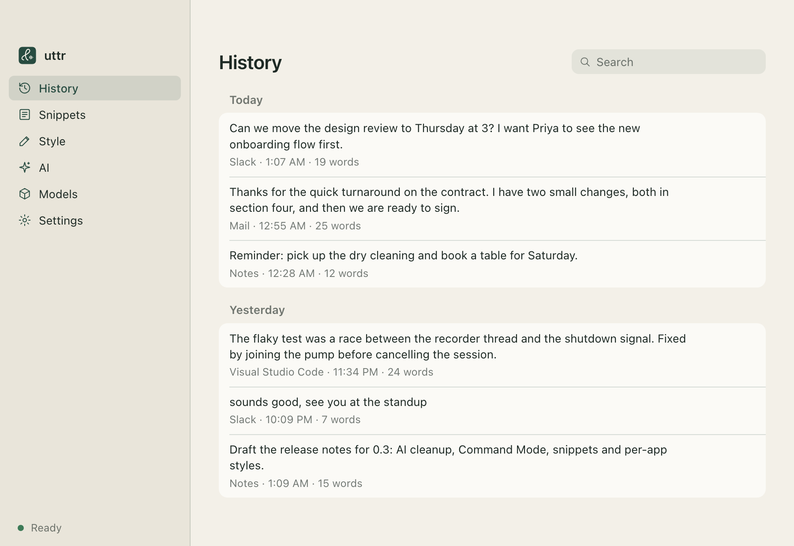
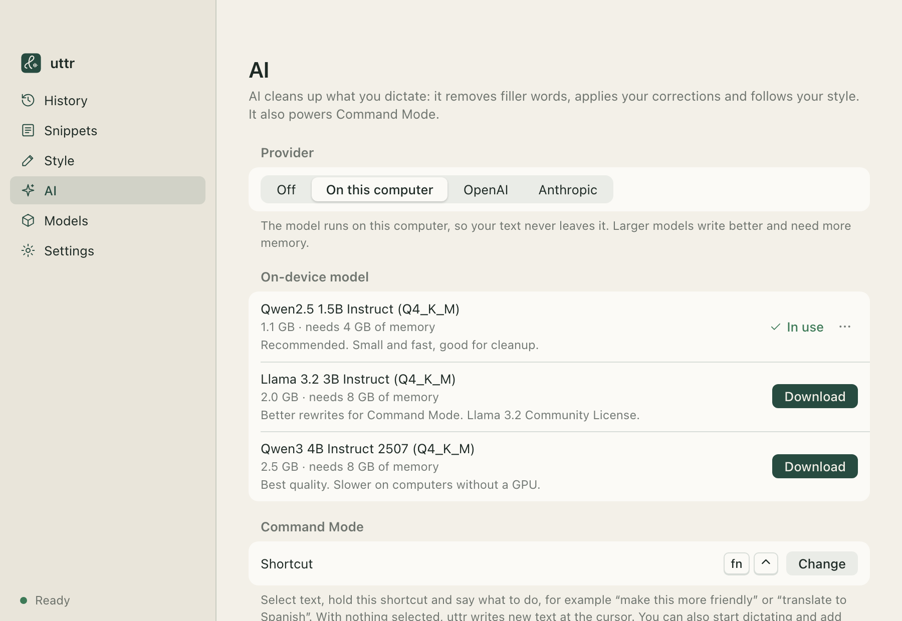
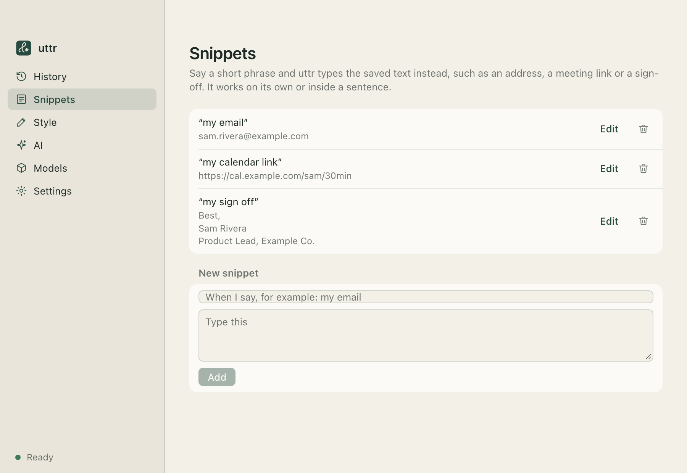
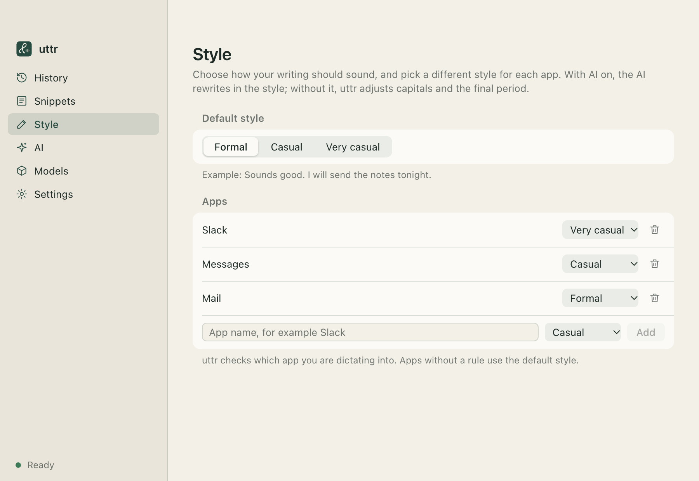
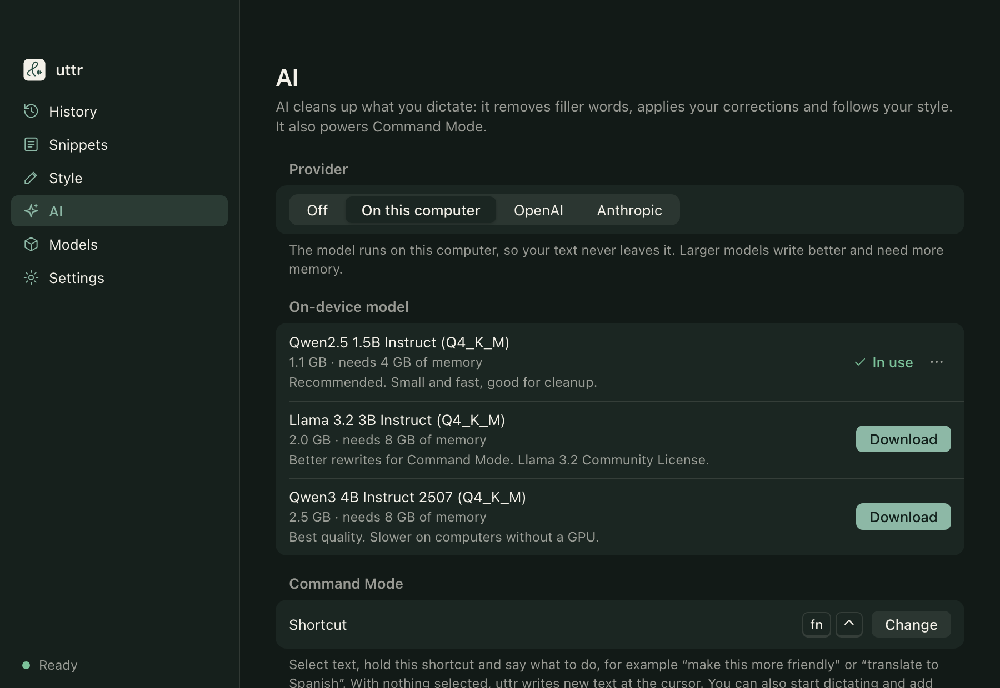
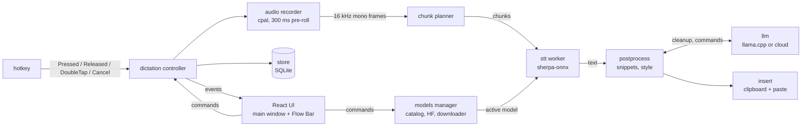

<p align="center">
  
</p>

# uttr

[](https://github.com/Lets-Decode-AI/uttr/actions/workflows/ci.yml)
[](LICENSE)
[](https://github.com/Lets-Decode-AI/uttr/releases/latest)

**Private push-to-talk dictation that runs on your computer.**

Hold a shortcut in any app, speak, and let go. Punctuated text appears at your cursor. uttr is an
open-source alternative to tools like Wispr Flow. The difference is that speech recognition runs
**on your computer** with [sherpa-onnx](https://github.com/k2-fsa/sherpa-onnx) models such as NVIDIA
Parakeet. Your audio never leaves your machine, and there is no account or subscription.

It is a small [Tauri 2](https://tauri.app) app (Rust core, React UI) that lives in the system tray.
The installer includes everything the app needs, including the ONNX Runtime libraries. You download
models from Hugging Face inside the app.

> Status: Part 1 (core dictation and the local model manager) and Part 2 (text intelligence: AI cleanup,
> Command Mode, snippets and per-app styles) are done. See the [Roadmap](#roadmap).

<p align="center">
  <picture>
    <source media="(prefers-color-scheme: dark)" srcset="docs/images/history-dark.png">
    
  </picture>
</p>

## Features

- Push-to-talk and hands-free dictation into any focused text field. Double-press the shortcut for hands-free, and press `Esc` to cancel.
- Speech-to-text with sherpa-onnx. Transcription does not use the network.
- In-app model manager with a list of recommended models, Hugging Face search, resumable downloads, SHA-256 verification, pause, resume, cancel and disk usage per model.
- A model that suits your hardware is recommended on first run.
- Streaming chunked transcription, so long dictations finish soon after you let go of the key.
- Flow Bar: a small pill on top of other windows that shows when uttr is listening, transcribing or done, and shows errors. It never takes focus.
- Text is inserted by pasting, and your clipboard (text or image) is restored afterwards. Only plain text and images are
  restored. Rich formatting (HTML or RTF) comes back as plain text. If the clipboard held something uttr cannot read,
  such as files, uttr leaves it alone instead of clearing it.
- Personal dictionary replacements, plus basic capitalization and spacing fixes.
- **AI cleanup** (optional): removes filler words, keeps only your self-corrections ("Tuesday, no, Wednesday"), fixes
  punctuation and formats spoken lists. Runs on your computer with a llama.cpp model, or with your own OpenAI or
  Anthropic API key. Any OpenAI-compatible server (Ollama, LM Studio) works too.
- **Command Mode**: select text, hold `Fn+Ctrl` (`Ctrl+Win+Alt` on Windows and Linux) and say what to do with it,
  such as "make this friendlier" or "translate to Spanish". With nothing selected, uttr writes new text at the cursor.
- **Snippets**: say a short phrase such as "my calendar link" and uttr types the saved text.
- **Styles per app**: formal, casual or very casual, chosen by the app you are dictating into (for example very casual in Slack, formal in Mail).
- Searchable history of your dictations, stored in SQLite on your machine.
- Low resource use. uttr stays in the tray at rest, and the model unloads after an idle timeout (10 minutes by default, or never).
- Optional Hugging Face token for gated or private repos, stored in the system keychain.
- Open at login, microphone selection and a configurable shortcut.

## Privacy

- Audio is processed on your device and is never uploaded; there is no account and no telemetry.
- The microphone stays open for up to 15 s after a dictation so the next one does not clip the first word. While it is open, only the latest 0.3 s of audio is held in memory.
  After 15 s it closes.
- The only network traffic is model downloads and searches on Hugging Face, which you start yourself.
- AI is off by default. On-device AI keeps your text on your computer. If you choose OpenAI or Anthropic, the
  dictated **text** (never the audio) is sent to that provider, and your API key is stored in the system keychain.
- Custom Hugging Face repos: files tracked with Git LFS are checked against their SHA-256. Other files
  (such as `tokens.txt`) are checked for size only, because Hugging Face publishes no hash for them.

## Screenshots

| AI cleanup and Command Mode | Snippets |
|---|---|
|  |  |
| **Styles per app** | **Dark theme** |
|  |  |

The screenshots use sample data. To retake them after a UI change, see [scripts/screenshots](scripts/screenshots/README.md).

## Install

Download the installer for your system from the
[Releases page](https://github.com/Lets-Decode-AI/uttr/releases/latest).

| OS | File | Notes |
|---|---|---|
| macOS (Apple Silicon) | `uttr_<version>_aarch64.dmg` | |
| macOS (Intel) | `uttr_<version>_x64.dmg` | |
| Windows (x64) | `uttr_<version>_x64-setup.exe` | NSIS installer |
| Linux (x64) | `.AppImage` or `.deb` | |

Models are not bundled. On first launch, setup downloads a recommended model
(Parakeet TDT 0.6B v2, about 660 MB, by default).

### macOS

Release builds may be **unsigned**. They are signed and notarized only if the maintainers have
configured signing certificates. If macOS says the app "is damaged" or "cannot be opened because
the developer cannot be verified":

1. Drag uttr to `/Applications`.
2. Try to open it once. Then go to System Settings > Privacy & Security, scroll to Security and click **Open Anyway** (macOS 15 and later).
3. Or run `xattr -dr com.apple.quarantine /Applications/uttr.app` in Terminal.

uttr needs two permissions. Setup walks you through them (System Settings > Privacy & Security):

- **Microphone**: records your voice.
- **Accessibility**: lets uttr read the global shortcut (the `Fn` key is read through an event tap) and send the paste keystroke.
  Until you grant it, uttr shows the message "Grant Accessibility access to turn on the shortcut." The shortcut starts working as soon as
  you grant it. You do not need to relaunch.

If you use the `Fn` or Globe key as the shortcut, set System Settings > Keyboard > "Press 🌐 key to" to **Do Nothing**.
Otherwise macOS may open the emoji picker or its own dictation at the same time.

### Windows

Run the installer. For unsigned builds, Windows SmartScreen may warn about an unrecognized publisher
(More info > Run anyway). The default shortcut is to hold `Ctrl+Win`.

### Linux

- **X11**: supported. The default shortcut is to hold `Ctrl+Super`.
- **Wayland**: the global shortcut is not available yet, and the app shows "The global shortcut is not available on Wayland."
  Use an X11 session for now. Where synthetic paste is blocked, the text stays on the clipboard and you paste it yourself.
  Support through the XDG GlobalShortcuts portal is on the [Roadmap](#roadmap).
- Make the AppImage executable (`chmod +x uttr_*.AppImage`) or install the `.deb` with `sudo apt install ./uttr_*.deb`.

## Supported models

The model list is bundled in the app ([`src-tauri/resources/catalog.json`](src-tauri/resources/catalog.json)),
with sizes and SHA-256 hashes pinned to specific Hugging Face revisions. You can also search Hugging Face
from the app for other sherpa-onnx repos. uttr detects compatible transducer, Whisper, Moonshine and SenseVoice layouts.

| Model | Engine | Download | Languages | Min RAM |
|---|---|---|---|---|
| Parakeet TDT 0.6B v2 (int8), **default** | Transducer | ~661 MB | English | 4 GB |
| Parakeet TDT 0.6B v3 (int8) | Transducer | ~670 MB | 25 European languages | 4 GB |
| Moonshine Base (int8) | Moonshine | ~286 MB | English | 2 GB |
| Whisper tiny.en (int8) | Whisper | ~103 MB | English | 2 GB |
| Whisper small.en (int8) | Whisper | ~375 MB | English | 3 GB |
| SenseVoice small (int8) | SenseVoice | ~239 MB | Chinese, English, Japanese, Korean, Cantonese | 2 GB |
| Whisper large-v3-turbo (int8) | Whisper | ~1 GB | Multilingual (35 languages listed in the catalog) | 6 GB |

On first run uttr recommends Moonshine Base on machines with little RAM, Parakeet v3 or SenseVoice when they match
your system language, and Parakeet v2 otherwise.

## AI cleanup and Command Mode

Choose a provider on the **AI** page:

| Provider | Where your text goes | Setup |
|---|---|---|
| Off (default) | Nowhere | Dictionary, snippets, styles and basic fixes still apply |
| On this computer | Nowhere | Download a model on the AI page; it runs with [llama.cpp](https://github.com/ggml-org/llama.cpp) (Metal on Apple Silicon) |
| OpenAI | OpenAI, or the OpenAI-compatible server you set | API key (not needed for local servers such as Ollama), model name (default `gpt-5-mini`) |
| Anthropic | Anthropic | API key, model name (default `claude-opus-5-5`) |

On-device models ([`src-tauri/resources/llm_catalog.json`](src-tauri/resources/llm_catalog.json), pinned and SHA-256 verified):

| Model | Download | Min RAM | Notes |
|---|---|---|---|
| Qwen2.5 1.5B Instruct (Q4_K_M), **recommended** | ~1.1 GB | 4 GB | Fast; good for cleanup |
| Llama 3.2 3B Instruct (Q4_K_M) | ~2.0 GB | 8 GB | Better rewrites for Command Mode |
| Qwen3 4B Instruct 2507 (Q4_K_M) | ~2.5 GB | 8 GB | Best quality; slower without a GPU |

How it fits together:

1. A snippet said on its own ("my email") is inserted as is, without AI.
2. Otherwise the transcript goes to the AI with your dictionary words and snippet phrases, so they are spelled
   exactly, and the style for the app you are dictating into. Dictations of one or two words skip the AI.
3. If the AI fails or answers instead of cleaning up, uttr inserts the plain transcript and says so in the Flow Bar.
4. The dictionary, the style's capitalization and period rules and snippet expansion are applied last.

Command Mode reads the selection with a synthetic copy (your clipboard is restored), sends your spoken instruction
and the selection to the AI, and pastes the answer over the selection. The Flow Bar shows **Command** while you speak.
You can also start a normal dictation and add the extra key to switch it to Command Mode.

### Measured performance

From the project's integration test (Parakeet v2 int8, release build, Apple Silicon Mac). Your hardware will differ.

- Clips of 4 to 6 s transcribe in roughly 360 to 530 ms. The best run took about 362 ms for a 5 s clip.
- A 62.5 s streamed dictation finishes about 421 ms after key-up.
- Word error rate was 0.0 on the project's synthetic text-to-speech fixtures. The set is small and is not a general accuracy benchmark.

## How streaming chunked transcription works

Transcribing a long recording in one pass would make you wait after you release the key. Instead, while you
speak, a **chunk planner** watches the live 16 kHz audio and cuts it at natural pauses:

- Once a chunk is at least 4 s long, it is cut at the first pause of 300 ms or more.
- If a chunk reaches 15 s without a pause, it is cut at the quietest 20 ms frame in the last 3 s.
- Finished chunks go to a single STT worker thread, which transcribes them **in order** in the background.
- Silent chunks are skipped.

When you release the key, only the short final chunk is left. The wait after key-up depends on that chunk, not on how
long you talked. uttr joins the chunk texts in order, post-processes them and pastes the result.

## Architecture



One Rust process owns audio, inference, hotkeys, I/O and persistence. The web UI only renders. Module map
(all under [`src-tauri/src`](src-tauri/src)):

| Module | Responsibility |
|---|---|
| `hotkey` | Global triggers (macOS `Fn` event tap, `rdev`, Wayland portal stub) and the tap and double-tap gesture logic |
| `audio` | `cpal` capture, resampling to 16 kHz mono, energy VAD, level meter |
| `dictation` | Pure state machine plus the controller that wires audio, STT, post-processing, insertion and storage |
| `stt` | `ChunkPlanner`, `SttSession`, the worker thread and the sherpa-onnx engine |
| `models` | Catalog, Hugging Face search, resumable verified downloader, hardware detection, lifecycle |
| `postprocess` | Spacing and capitalization fixes, dictionary replacements |
| `llm` | AI cleanup and Command Mode: prompts, the llama.cpp worker, OpenAI and Anthropic clients |
| `style`, `snippets` | Per-app writing styles; snippet matching and expansion |
| `insert` | Clipboard save and restore, synthetic paste, frontmost-app lookup |
| `store` | SQLite: transcripts, settings, dictionary, snippets, downloads, migrations |
| `permissions` | Per-OS permission checks and deep links |
| `commands`, `events`, `tray`, `app_state` | Tauri command layer, event names, tray menu, shared state |

The React/TypeScript UI is in [`src`](src) (`flowbar.html` is the Flow Bar window).

## Build from source

Prerequisites: [Rust](https://rustup.rs) (the toolchain is pinned to 1.99.1 by `rust-toolchain.toml`; Rust 1.88 or newer is required), Node.js 20 or newer,
and the platform dependencies for [Tauri 2](https://tauri.app/start/prerequisites/). On Ubuntu:

```bash
sudo apt-get install -y libwebkit2gtk-4.1-dev libayatana-appindicator3-dev librsvg2-dev libasound2-dev libxdo-dev libxtst-dev libxi-dev cmake clang
```

```bash
git clone https://github.com/Lets-Decode-AI/uttr.git
cd uttr
npm ci
npm run tauri dev      # run the app with hot reload
npm run tauri build    # produce an installer for your OS in src-tauri/target/release/bundle
```

The first build downloads prebuilt sherpa-onnx binaries and compiles a lot of Rust, so it takes a while.
On macOS, grant Microphone and Accessibility to the terminal or app you launch it from when you test the shortcut.

## Running tests

```bash
# Rust unit tests
cd src-tauri && cargo test

# Lint and formatting (also run in CI)
cargo fmt --check
cargo clippy --all-targets -- -D warnings

# Frontend
cd .. && npx tsc --noEmit && npx tsc -p tsconfig.test.json --noEmit && npx vitest run
```

The real-model integration tests (word error rate on fixtures, streaming latency) are `#[ignore]`d because they need a
~660 MB model. To run them:

```bash
scripts/fetch_test_model.sh          # downloads Parakeet v2 int8 to ~/Library/Caches/uttr Test é/parakeet-v2
cd src-tauri
UTTR_MODEL_DIR="$HOME/Library/Caches/uttr Test é/parakeet-v2" \
  cargo test --release --test stt_integration -- --ignored --nocapture
```

On Linux pass a destination directory to the script and use the same path for `UTTR_MODEL_DIR`.

The on-device AI tests run real llama.cpp inference on any GGUF chat model (the recommended Qwen2.5 1.5B is ~1.1 GB):

```bash
cd src-tauri
UTTR_LLM_MODEL="$HOME/Downloads/qwen2.5-1.5b-instruct-q4_k_m.gguf" \
  cargo test --release --test llm_integration -- --ignored --nocapture
```
The manual end-to-end checks for dictation in real apps are listed in [docs/E2E-CHECKLIST.md](docs/E2E-CHECKLIST.md).

## Roadmap

- **Linux/Wayland**: global shortcuts through the XDG GlobalShortcuts portal.
- ~~**Part 2, text intelligence**: local LLM cleanup (llama.cpp), an optional API key for OpenAI or Anthropic,
  Command Mode, snippets and per-app styles.~~ Done.
- **Part 3, dashboard**: a dashboard like Wispr's with words, WPM, streaks and time saved, plus full history.

Not planned for Part 1: auto-update, accounts or sync. Release process: [docs/RELEASING.md](docs/RELEASING.md).

## Contributing

Contributions are welcome. Read [CONTRIBUTING.md](CONTRIBUTING.md) and the
[Code of Conduct](CODE_OF_CONDUCT.md) first. Report security issues privately as described in [SECURITY.md](SECURITY.md).
For questions, see [SUPPORT.md](SUPPORT.md).

## License

[MIT](LICENSE) (c) 2026 Lets Decode AI.

## Acknowledgements

- [sherpa-onnx](https://github.com/k2-fsa/sherpa-onnx) (k2-fsa), the [`sherpa-rs`](https://github.com/thewh1teagle/sherpa-rs) bindings, and [csukuangfj](https://huggingface.co/csukuangfj) for the converted model repos.
- [NVIDIA NeMo Parakeet](https://huggingface.co/nvidia/parakeet-tdt-0.6b-v2) speech models.
- [OpenAI Whisper](https://github.com/openai/whisper), [Moonshine](https://github.com/moonshine-ai/moonshine) and [SenseVoice](https://github.com/FunAudioLLM/SenseVoice) models.
- [Tauri](https://tauri.app) for the app framework.
- Inspired by [Wispr Flow](https://wisprflow.ai). uttr is an independent project and is not affiliated with Wispr.

Model weights are downloaded from their upstream repositories and remain under their own licenses.
